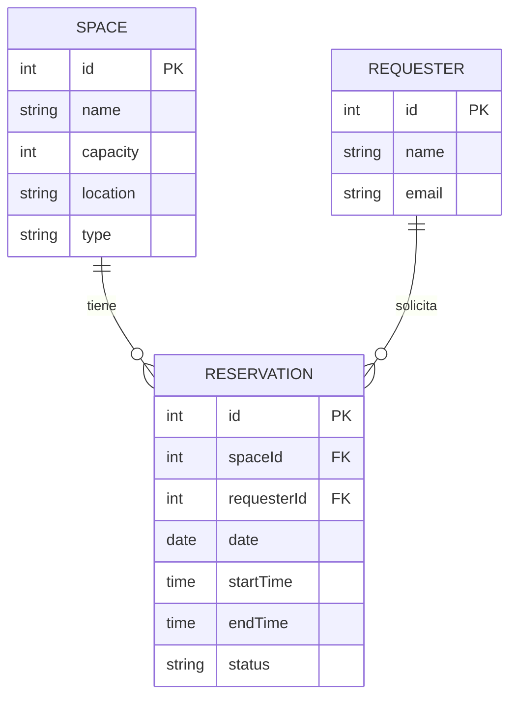

# Modelo de datos: Reservas de Espacios

Tres entidades. Hoy la API implementa `Space` y `Requester`; `Reservation` es la relación entre ambas y es la siguiente etapa.

## Tablas

**Space** (espacio físico)

| Columna  | Tipo   | Notas                                            |
|----------|--------|--------------------------------------------------|
| id       | número | clave primaria                                   |
| name     | texto  | obligatorio                                      |
| capacity | número | obligatorio, mayor que 0                         |
| location | texto  | por ejemplo "Bloque B"                           |
| type     | texto  | salon, laboratorio, cancha, auditorio            |

**Requester** (quien solicita la reserva)

| Columna | Tipo  | Notas                    |
|---------|-------|--------------------------|
| id      | número| clave primaria           |
| name    | texto | obligatorio              |
| email   | texto | obligatorio, único       |

**Reservation** (relación entre espacio y solicitante)

| Columna     | Tipo   | Notas                                         |
|-------------|--------|-----------------------------------------------|
| id          | número | clave primaria                                |
| spaceId     | número | referencia a Space                            |
| requesterId | número | referencia a Requester                        |
| date        | fecha  |                                               |
| startTime   | hora   |                                               |
| endTime     | hora   | posterior a startTime                         |
| status      | texto  | pendiente, confirmada o cancelada             |

## Regla de negocio y combinación que no debe repetirse

No puede existir una reserva confirmada para el mismo `spaceId` cuyo horario (`date`, `startTime`–`endTime`) se cruce con otra reserva confirmada del mismo espacio. Esto evita que dos personas reserven el mismo espacio a la misma hora.

## Roles previstos

- **ADMIN:** gestiona espacios.
- **COORDINATOR:** aprueba o rechaza reservas.
- **USER:** solicita reservas.
